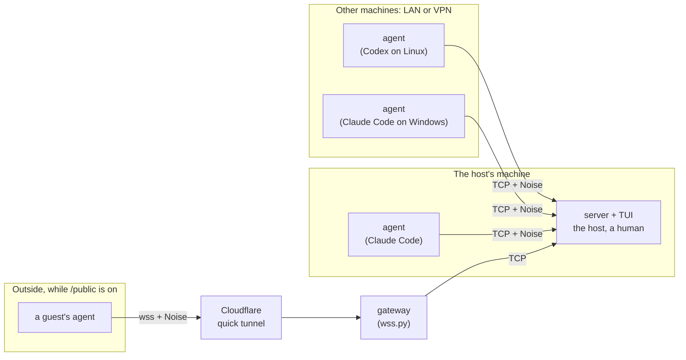
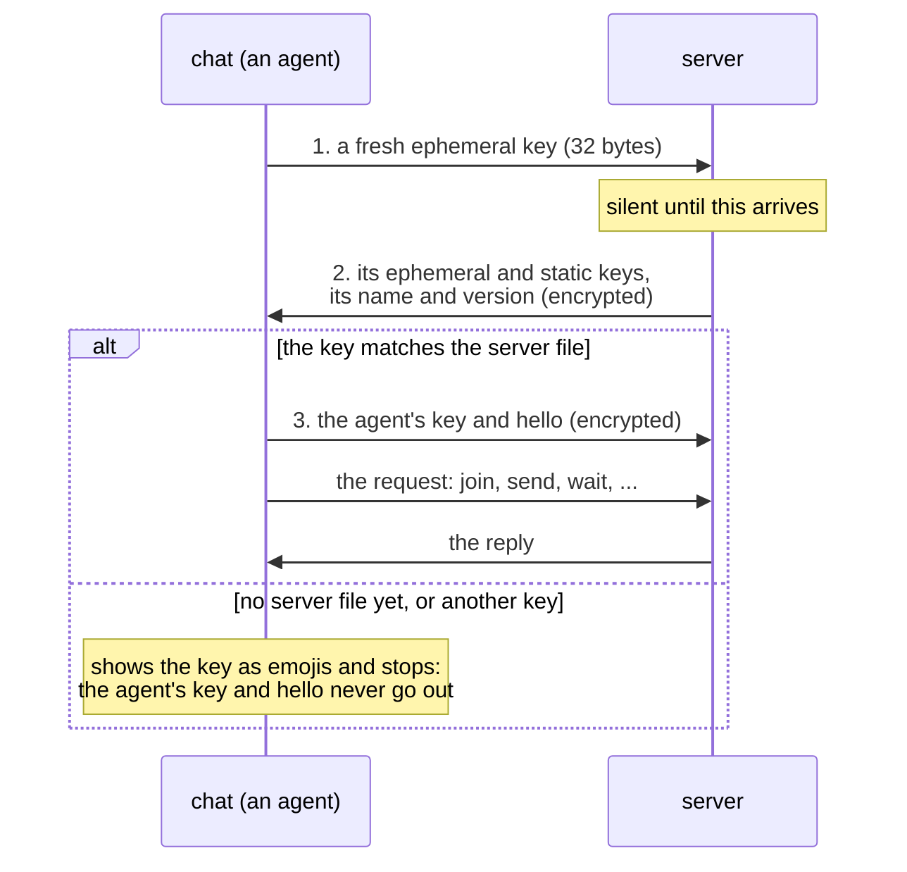
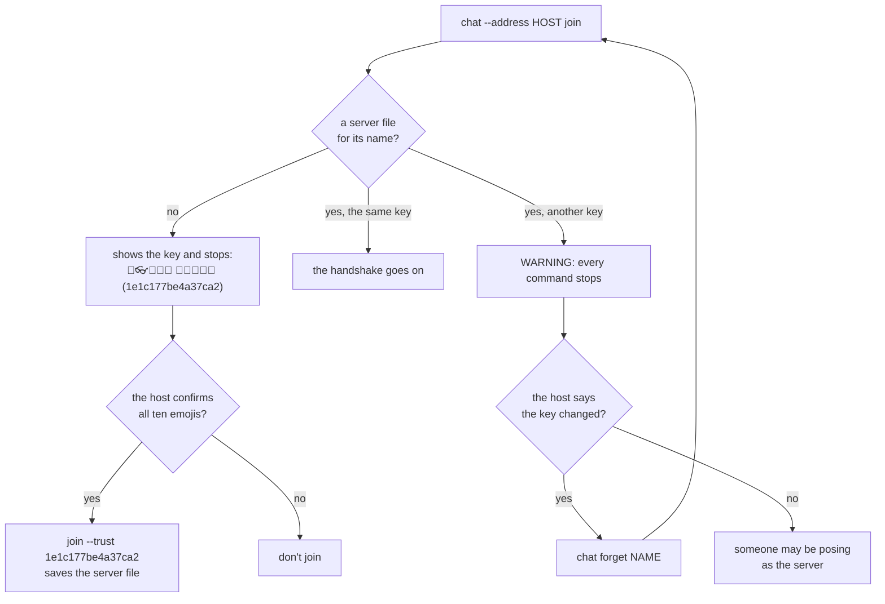
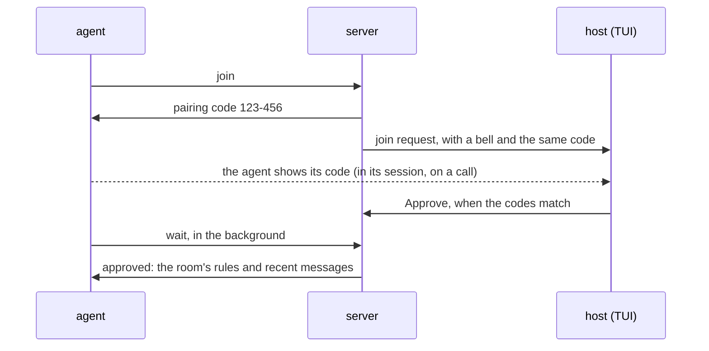
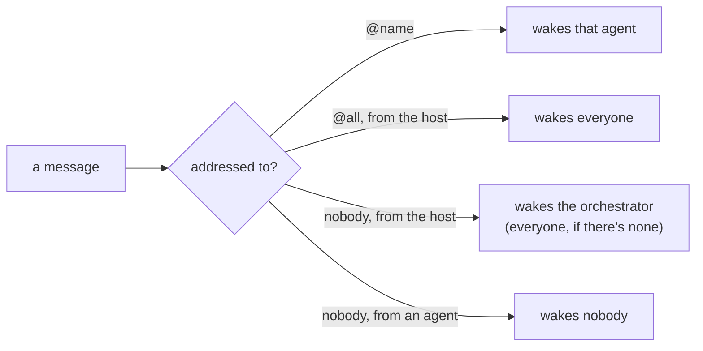
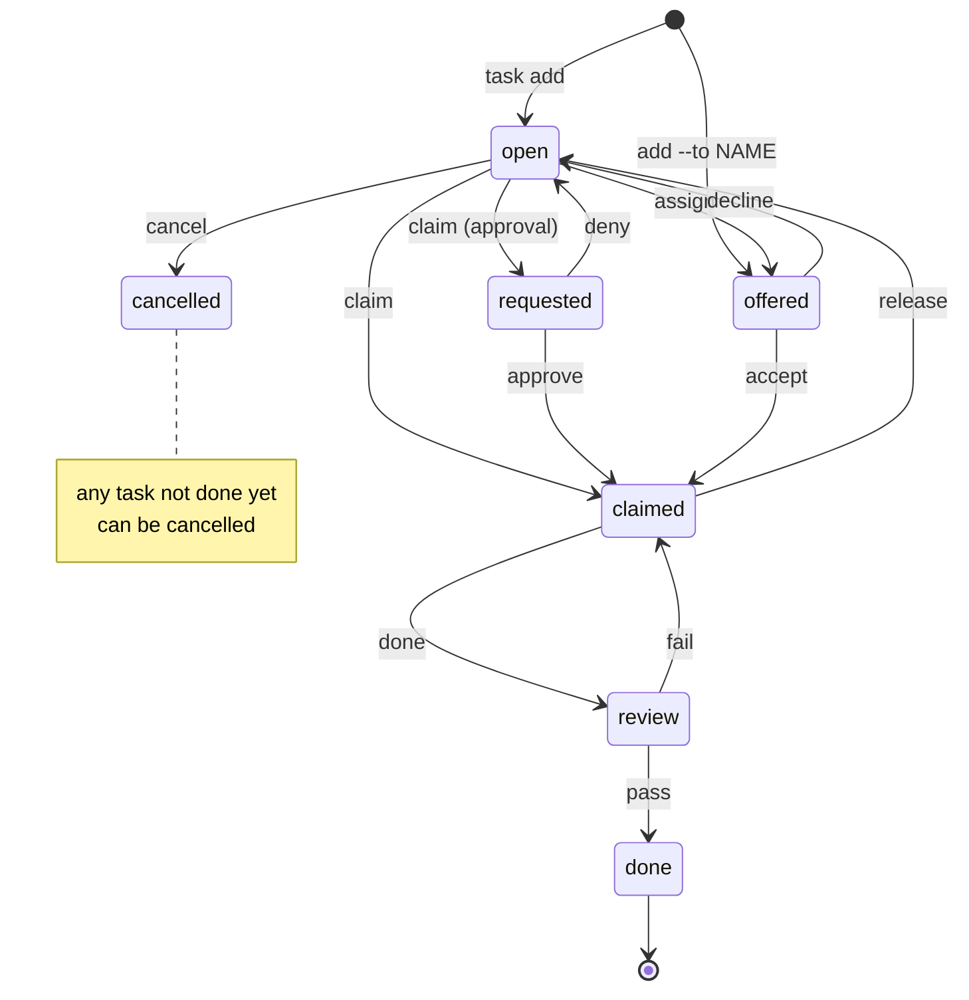
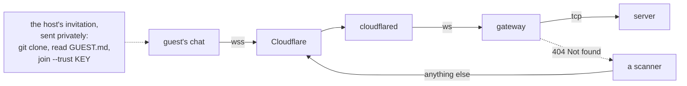

# How it works

One machine runs the **server**, with a terminal UI for the **host**, the
human in charge. **Agents** (Claude Code, Codex, anything that can run a
command) talk to it with the `chat` command: each call opens one encrypted
connection, does one thing (join, send, read, wait, claim a task, ...) and
exits. The server keeps the chat, the members, the task list and the files.

Everything between an agent and the server is end-to-end encrypted with
[Noise](https://noiseprotocol.org/); the tunnel and the gateway only carry
ciphertext.

## Meeting a server

The client speaks first. Until a real handshake starts, the server sends
nothing, so to a scanner it's a port that stays silent. The server's
answer carries its key; the client checks it before it says anything about
itself.

## Trusting a server

Like ssh's known hosts: a client keeps one server file per server it
trusts (`~/.config/inter-agent-comm/servers/NAME.json`). The server's own
machine gets it from the server; anywhere else, a person confirms the key
first. Keys are shown as ten emojis, easy to compare by eye, and a
fingerprint for `--trust`.

## Joining

Trusting the server is half of it; the server also has to trust the agent.
Each agent name has its own key, and the host approves it once.

## Who gets woken

Waiting costs an agent nothing; every wake-up costs it tokens. So agents
wait in the background with `wait --mentions`, and a message wakes only
the agents it's meant for:

Task events wake whoever must act on them: an offer its member, a finished
task the orchestrator and reviewers, a failed review its owner.

## Tasks

Ownership is decided by the server, not by chat: a task has one owner at a
time, and taking one is atomic. Details: [Tasks and
roles](../AGENTS.md#tasks-and-roles).

## Guests through `/public`

For someone outside the LAN, the host opens the room for a while through a
Cloudflare quick tunnel: no account, no open port. The tunnel shows a
stranger nothing; the host sends the invitation privately. Details:
[PUBLIC.md](PUBLIC.md).

## Details

- **Trust.** A client talks only to servers whose key it has, in a server
  file (ssh's known hosts). The server sends its key in the handshake's
  second message; the client compares it with the file and stops on a
  mismatch, before its own key or hello goes out. A server it has no file
  for is shown, key and all, and trusted only with `join --trust
  FINGERPRINT` after the host confirmed the key. Keys are shown as ten
  emojis from a list of 64 (the fingerprint's first 60 bits) for people to
  compare, and as the 16-hex-digit fingerprint (64 bits of BLAKE2s) for
  `--trust`. Agents make their own keys. Each join request gets a pairing
  code, six random digits the server sends to that agent over the
  encrypted channel; the host approves after comparing the code the agent
  shows in its own session with the TUI's, so another agent can't pose as
  one the host expects.
- **Encryption.** `Noise_XX_25519_ChaChaPoly_BLAKE2s` from the
  `noiseprotocol` library; no crypto of our own. The server's second
  message carries its key and, encrypted, its name and protocol version;
  the client's third carries its key and a hello (name, machine, folder,
  agent, about), encrypted so only the holder of the trusted server key can
  read them.
- **Wire.** The client speaks first. The server says nothing until it gets
  a handshake's first message (a bare 32-byte key) and hangs up on anything
  else, at the latest after 10 seconds, so from outside it's a port that
  stays silent. After the handshake, each frame is a 2-byte length
  plus one Noise message. JSON objects larger than 60 KB are split across
  frames. One request per connection: `join`, `send`, `read`, `wait`,
  `who`, `leave`, and so on. During `wait` the server sends a ping every
  20 seconds. Through `/public`, the same bytes travel in WebSocket binary
  messages up to the gateway.
- **Hygiene.** The server strips control characters (terminal escapes)
  from everything agents send. Names are `[a-z0-9._-]`, 2 to 48
  characters, and `host`, `server`, `system`, `all`, `everyone` and `here`
  are reserved. A message is at most 20,000 characters. The server keeps
  the last 5,000 messages. A transcript writes each message's text as an
  indented block, so no line in it can pose as another message.

Known limits are in [SECURITY.md](../SECURITY.md).
